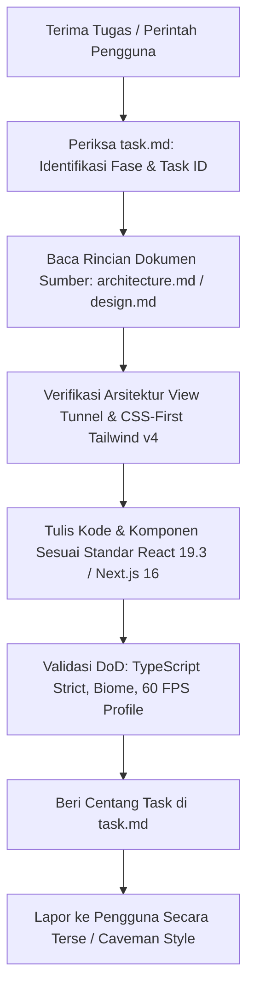

# NOIR // KINETIC — AI Agents Master Orchestration & Navigation Guide (`AGENTS.md`)

> **Untuk AI Coding Assistant (Antigravity, Claude, Cursor, Copilot, dll):**
> Dokumen ini adalah **peta orkestrasi utama (master index & orchestration layer)** untuk repository **NOIR // KINETIC**.
> Dokumen ini **TIDAK** menduplikasi seluruh detail implementasi. Seluruh spesifikasi definitif, arsitektur WebGL/DOM, sistem desain visual, dan instruksi tugas tersimpan secara terpisah dalam dokumen sumber. **Buka dan baca file referensi terkait saat mengerjakan tugas tertentu.**

---

## 1. Ikhtisar & Misi Sistem

**NOIR // KINETIC** adalah website portofolio & *flagship spatial case study* berkinerja tinggi yang menggabungkan estetika **Industrial Brutalism** ([Mr. BLACK Franchise](https://mrblack-case.dolganev.com/)) dan **Avant-Garde 3D Luxury Editorial** ([Nothin' Creative Studio](https://www.noth.in/)).

Sistem dibangun menggunakan stack modern akhir 2026:
- **Core Web Framework**: [Next.js 16.4.x](https://nextjs.org/) (App Router, Turbopack bawaan, explicit caching, Server Actions).
- **UI Library & Compiler**: [React 19.3.x](https://react.dev/blog/2026/09/09/react-19-3) dengan **React Compiler 1.0** (otomatis tanpa `useMemo`/`useCallback` manual), `ref` langsung sebagai prop biasa, dan View Transitions.
- **Styling**: [Tailwind CSS v4.1.x](https://tailwindcss.com/blog/tailwindcss-v4-1) berbasis Rust Oxide engine, arsitektur **CSS-first** via direktif `@theme` di `globals.css` (tanpa `tailwind.config.js`), ruang warna **OKLCH**, dan utilitas `.brutalist-cell`.
- **3D Engine**: [Three.js](https://threejs.org/) + [@react-three/fiber](https://www.npmjs.com/package/@react-three/fiber) `v9.8.x` + [@react-three/drei](https://www.npmjs.com/package/@react-three/drei) `v10.7.x`.
- **Motion & Ticker**: [GSAP v3.12+](https://gsap.com/) (`@gsap/react`, `ScrollTrigger`, `quickTo`) + [Lenis](https://lenis.dev/) smooth scrolling (`lenis/react`).
- **State**: [Zustand v5.x](https://github.com/pmndrs/zustand) untuk jembatan ringan DOM-to-WebGL state (preloader, menu, cursor, scroll velocity, active theme).
- **Core Visual Paradigm**: **Single Persistent WebGL Canvas with Viewport Scissoring ("View Tunnel Pattern")** + **Unified Ticker Loop** (Lenis + GSAP + R3F) untuk mengunci 60 FPS tanpa *scroll jitter*.

---

## 2. Hub Dokumen Sumber (Canonical Source of Truth)

Setiap agen AI **WAJIB** merujuk pada dokumen sumber berikut berdasarkan konteks tugas:

| Dokumen | Path | Peran & Cakupan | Kapan Harus Dibaca |
|---|---|---|---|
| **ARCHITECTURE** | [architecture.md](./architecture.md) | Arsitektur Hybrid DOM + Single WebGL Canvas (*View Tunnel Pattern*), struktur folder `src/`, kode inti (`globals.css`, `useSmoothScroll`, `GlobalCanvas`), pipeline aset 3D (.glb, KTX2, Meshopt/Draco), dan anggaran Core Web Vitals (LCP < 1.6s, INP < 100ms, 60 FPS). | Saat mengatur struktur folder, canvas R3F, shader GLSL/TSL, store Zustand, hook sinkronisasi Lenis-GSAP, atau konfigurasi Next.js/Turbopack. |
| **DESIGN** | [design.md](./design.md) | Filosofi *Brutalist Luxury Meets Kinetic 3D*, token warna OKLCH (obsidian, industrial sage, editorial bone, terracotta volt), tipografi variabel (Syne, Neue Montreal, JetBrains Mono), grid brutalist 12 kolom 1px, blueprint 6 seksi halaman, Preloader 0-100%, kursor magnetik dual-state, micro-interactions, serta GPU tiering & aksesibilitas. | Saat membangun komponen UI/DOM, styling Tailwind v4, animasi GSAP, shader visual, kalkulator interaktif, atau seksi halaman. |
| **TASK** | [task.md](./task.md) | Roadmap 5 Fase implementasi (Fase 1 s.d. 5, tugas 1.1 s.d. 5.3), deliverable utama per fase, checklist langkah detail per tugas, kriteria verifikasi, dan audit performa/aksesibilitas. | **Setiap saat sebelum dan sesudah menulis kode.** Digunakan untuk mengambil tugas berikutnya dan menandai progres `[x]`. |

### Hierarki Resolusi Konflik (*Precedence Rule*):
1. **`task.md`** adalah otoritas tertinggi untuk prioritas pengerjaan, milestone, dan checklist verifikasi tugas.
2. **`architecture.md`** adalah otoritas tertinggi untuk arsitektur teknis, kontrak data, render loop, WebGL tunnel, dan integrasi library.
3. **`design.md`** adalah otoritas tertinggi untuk sistem visual, token warna OKLCH, tata letak grid, tipografi, anatomi komponen, dan koreografi gerak.

---

## 3. Aturan Inti Proyek & Guardrails (Mandatory Project Rules)

### 3.1. Arsitektur Single Persistent Canvas ("View Tunnel Pattern")
- **DILARANG KERAS** membuat elemen `<Canvas>` terpisah di tiap seksi. Membuat multi-canvas akan menghabiskan batas *WebGL Context* browser dan merusak performa (*jank*).
- Hanya ada **SATU** `<Canvas>` utama yang dipasang di `src/components/canvas/GlobalCanvas.tsx` (`fixed inset-0 pointer-events-none z-[15]`) dan di-mount di `src/app/layout.tsx`.
- Komponen seksi HTML cukup menyediakan target mount `
`, lalu merender portal 3D menggunakan `<View track={viewRef}>` dari `@react-three/drei`.
- **Stacking Context Guardrail**: Background seksi DOM default berada pada level `z-0` (transparan di level section, atau mengandalkan dynamic background `document.body`). Dilarang memberikan background solid opaque dengan `z-index` tinggi pada parent section (seperti `z-20`) karena akan menutupi `<GlobalCanvas />` di `z-[15]`. Elemen tombol kontrol atau form interaktif dapat memakai `z-20`.

### 3.2. Unified Render Loop & Zero Scroll Jitter
- Ticker [Lenis](https://lenis.dev/), [GSAP](https://gsap.com/) `ScrollTrigger`, dan `useFrame` [@react-three/fiber](https://www.npmjs.com/package/@react-three/fiber) **WAJIB** disinkronkan ke dalam satu siklus `requestAnimationFrame` terpusat (`gsap.ticker.add(...)` dan `gsap.ticker.lagSmoothing(0)`).
- Dilarang membajak scrollbar asli browser secara sembarangan; gunakan instans Lenis dengan parameter halus (`lerp: 0.08`, `wheelMultiplier: 0.9`). Kunci scroll (`lenis.stop()`) saat Preloader atau Fullscreen Menu aktif.
- **CSS Sticky Track untuk Transisi Spasial**: Untuk seksi dengan scrub zoom visual mendalam (seperti *Spatial Museum Gallery Dolly Zoom*), gunakan arsitektur **CSS Sticky Track** (`h-[300vh]` outer track + `sticky top-0 h-screen` inner viewport) daripada GSAP `pin: true`. Ini mencegah inject `.pin-spacer` yang merusak layout flexbox/grid dan menghindari tabrakan dengan seksi di bawahnya.

### 3.3. Standar Tailwind CSS v4 (CSS-First, Tanpa `tailwind.config.js`)
- **DILARANG** membuat atau mencari file `tailwind.config.js`. [Tailwind CSS v4](https://tailwindcss.com/blog/tailwindcss-v4) menggunakan arsitektur CSS-first.
- Semua token warna (`--color-obsidian`, `--color-industrial-sage`, `--color-editorial-bone`, `--color-terracotta-volt`), font, dan kurva bezier dideklarasikan di dalam blok `@theme` di `src/app/globals.css`.
- Gunakan utilitas `.brutalist-cell` untuk border `1px` presisi pada sel bento grid tanpa menghasilkan celah border ganda.

### 3.4. Kepatuhan React 19.3 & Next.js 16 App Router
- Manfaatkan **React Compiler 1.0** (`reactCompiler: true` di `next.config.ts`). Hindari penggunaan `useMemo` dan `useCallback` defensif yang tidak esensial.
- Gunakan `ref` langsung sebagai prop standar komponen; jangan gunakan `forwardRef` lawas.
- Manfaatkan React 19 **Server Actions** (`useActionState`) untuk formulir kontak terminal di footer.
- Pisahkan lapisan Server Components (RSC) untuk teks/grid/SEO dan Client Components (`"use client"`) untuk WebGL Canvas, listener kursor, serta GSAP animations.

### 3.5. Pipeline Aset 3D & Anggaran Performa GPU
- Ukuran file model 3D (`.glb`) **wajib < 850 KB** per model (dikompresi dengan `gltf-transform meshopt` atau Draco).
- Tekstur gambar wajib dalam format KTX2 GPU-native atau WebP/AVIF.
- Kalkulasi deformasi permukaan 3D yang intensif harus dijalankan di GPU via *Vertex Shader* GLSL, bukan di *main thread* JavaScript.
- Terapkan `useGpuTier.ts` untuk adaptive DPR: perangkat hemat daya/mobile menggunakan `dpr: 1` dengan material matcap, perangkat high-end menggunakan `dpr: 2` dengan `MeshTransmissionMaterial`.
- Lakukan *off-screen culling* pada portal `<View>` yang berada di luar viewport.

### 3.6. Protokol Keamanan & Zero Hardcoded Secrets
- **Zero Hardcoded Secrets**: Dilarang menuliskan API key, token, email kredensial, atau secret key di kode frontend.
- Gunakan *environment variables* yang divalidasi skema Zod pada sisi server (Next.js server-side / Server Actions) dan sediakan `.env.example`.

### 3.7. Disiplin Rekayasa & Refactoring Aman (Safe Refactor)
- **TypeScript Strict**: Seluruh kode ditulis dengan `strict: true`, termasuk pengetikan props R3F dan uniforms shader. Dilarang menggunakan `any`.
- **Konsistensi Struktur & Penamaan**: Ikuti struktur direktori di [architecture.md §3](./architecture.md#3-struktur-direktori-proyek-nextjs-16-app-router). Gunakan `kebab-case` untuk file utilitas/hook dan `PascalCase` untuk komponen React.
- **Dokumentasi Terkontrol**: Dilarang membuat file Markdown baru (seperti README atau ringkasan) tanpa izin eksplisit pengguna.

### 3.8. Standar Responsivitas Mobile & Gesture Prioritas
- **Touch-Action Pan-Y**: Seluruh elemen View tunnel WebGL wajib menerapkan `touch-action: pan-y` agar guliran vertikal halaman di layar sentuh tidak dibajak oleh manipulasi rotasi 3D.
- **Eliminasi Blank Whitespace**: Hindari class tinggi tetap desktop seperti `min-h-[1400px]` pada kontainer grid mobile; gunakan prefix breakpoint eksplisit (contoh: `min-h-0 lg:min-h-[1400px]`).
- **Adaptasi Skala Video & Track Sticky**: Track dolly zoom pada mobile dikurangi ke `h-[180vh]` dengan lebar frame video `w-[90vw]` untuk kenyamanan scrolling jempol.
- **Thumbnail Proyek Inline**: Pada baris portofolio mobile, sertakan thumbnail foto mini inline sebagai kompensasi kursor hover WebGL desktop.

---

## 4. Peta Navigasi Cepat (AI Agent Routing Map)

Gunakan tabel ini untuk melompat langsung ke topik dan seksi dokumen yang relevan:

| Topik / Kebutuhan Implementasi | File & Seksi Referensi |
|---|---|
| **Roadmap Pengerjaan & Checklist Tugas** | [task.md § Ringkasan Fase Pengerjaan s.d. Fase 5](./task.md#ringkasan-fase-pengerjaan) |
| **Tech Stack Standar 2026 & Matriks Dependensi** | [architecture.md §1](./architecture.md#1-spesifikasi-tech-stack-terbaru-standar-produksi-akhir-2026) |
| **Arsitektur Hybrid DOM + WebGL (View Tunnel)** | [architecture.md §2](./architecture.md#2-arsitektur-hybrid-dom--single-persistent-webgl-canvas-view-tunnel-pattern) |
| **Struktur Direktori Proyek (`src/app`, `components`)** | [architecture.md §3](./architecture.md#3-struktur-direktori-proyek-nextjs-16-app-router) |
| **Konfigurasi CSS-First Tailwind v4 & `@theme`** | [architecture.md §4.1](./architecture.md#41-konfigurasi-css-first-di-tailwind-css-v4-srcappglobalscss) & [design.md §2](./design.md#2-sistem-warna--token-atmosferik-oklch-color-space) |
| **Sinkronisasi Lenis + GSAP ScrollTrigger Ticker** | [architecture.md §4.2](./architecture.md#42-jembatan-sinkronisasi-lenis--gsap-scrolltrigger-srchooksusesmoothscrollts) |
| **Implementasi Single Persistent Canvas** | [architecture.md §4.3](./architecture.md#43-single-persistent-canvas--shader-interaktif-srccomponentscanvasglobalcanvasfortsx) |
| **Anggaran Core Web Vitals & Optimasi GPU** | [architecture.md §5](./architecture.md#5-pipeline-aset-strategi-caching--target-performa-core-web-vitals) & [design.md §7](./design.md#7-standar-aksesibilitas-responsivitas--performa-ui) |
| **Sistem Warna OKLCH & Transisi Latar Belakang** | [design.md §2](./design.md#2-sistem-warna--token-atmosferik-oklch-color-space) |
| **Sistem Tipografi Editorial & Variable Fonts** | [design.md §3](./design.md#3-sistem-tipografi--hierarki-editorial) |
| **Sistem Grid 12 Kolom 1px & Breakpoints** | [design.md §4](./design.md#4-sistem-grid-layout--breakpoints-responsif) |
| **Standar Responsivitas & Gesture Mobile** | [AGENTS.md §3.8](./AGENTS.md#38-standar-responsivitas-mobile--gesture-prioritas) & [design.md §4](./design.md#4-sistem-grid-layout--breakpoints-responsif) |
| **Preloader 0-100% & Boot Diagnostics** | [design.md §5.1](./design.md#51-tactile-boot-preloader-0--100) & [task.md §2.3](./task.md#fase-2-core-motion-engine-preloader--sistem-navigasi) |
| **Fixed HUD Navbar & Full-Screen Menu Overlay** | [design.md §5.2](./design.md#52-fixed-hud-navbar--full-screen-kinetic-overlay-menu) & [task.md §2.4](./task.md#fase-2-core-motion-engine-preloader--sistem-navigasi) |
| **Hero 3D Chrome Torus & Dispersion Shader** | [design.md §5.3](./design.md#53-hero-section-3d-interactive-chrome-sculpture--brutalist-hud) & [task.md §3.2 & §4.1](./task.md#fase-3-webgl-3d-pipeline--shader-interaktif) |
| **Bento Metrics & SVG ScrollTrigger Charts** | [design.md §5.4](./design.md#54-section-02-dynamic-metrics--architecture-bento-grid) & [task.md §4.2](./task.md#fase-4-pembangunan-seksi-halaman--interaksi-konten) |
| **Portfolio Showcase & WebGL RGB Wave Hover** | [design.md §5.5](./design.md#55-section-03-avant-garde-portfolio-showcase-selected-works) & [task.md §3.3 & §4.3](./task.md#fase-3-webgl-3d-pipeline--shader-interaktif) |
| **Spatial Museum Gallery & Video Dolly-Zoom Transition** | [design.md §5.5b](./design.md#55b-spatial-museum-gallery--manifesto-video-transition-nothin-spec) & [task.md §4.3b](./task.md#fase-4-pembangunan-seksi-halaman--interaksi-konten) |
| **Sticky Comparison & Interactive ROI Calculator** | [design.md §5.6](./design.md#56-section-04-sticky-split-screen-format--tier-comparison) & [task.md §4.4](./task.md#fase-4-pembangunan-seksi-halaman--interaksi-konten) |
| **Pocket HUD Camera Interface (`REC ●`)** | [design.md §5.7](./design.md#57-section-05-system-in-your-pocket--interactive-hud--mobile-preview) & [task.md §4.5](./task.md#fase-4-pembangunan-seksi-halaman--interaksi-konten) |
| **Accordion Specs & Kinetic Marquee Footer** | [design.md §5.8](./design.md#58-section-06-interactive-accordion-specs--kinetic-footer---bg-terracotta-volt) & [task.md §4.6](./task.md#fase-4-pembangunan-seksi-halaman--interaksi-konten) |
| **Kursor Magnetik Dual-State (`gsap.quickTo`)** | [design.md §6](./design.md#6-spesifikasi-koreografi-motion-kursor--micro-interactions) & [task.md §2.5](./task.md#fase-2-core-motion-engine-preloader--sistem-navigasi) |

---

## 5. Alur Kerja Eksekusi AI (Agent Execution Protocol)

Setiap agen AI yang menerima instruksi harus mengikuti siklus kerja standar berikut:

### Langkah Standar:
1. **Identifikasi Task:** Buka [task.md](./task.md) untuk memastikan nomor tugas (misal `1.1`, `2.3`, `3.2`). Pastikan dependensi tugas sebelumnya telah terpenuhi.
2. **Navigasi Konteks:** Buka file sumber spesifikasi yang ditunjuk di tabel navigasi ([architecture.md](./architecture.md) atau [design.md](./design.md)).
3. **Implementasi Kode Bersih:**
   - Pertahankan pemisahan RSC vs Client Component.
   - Sambungkan portal 3D ke `<GlobalCanvas />` via `<View track={ref}>`.
   - Hindari `any` dan hindari duplikasi border grid.
4. **Verifikasi Definition of Done (DoD Gate):**
   - Pemeriksaan tipe TypeScript lolos tanpa error (`tsc --noEmit`).
   - Linter/formatter (Biome) bersih.
   - Render loop sinkron tanpa getaran (*zero scroll jitter*).
   - Core Web Vitals terjaga (LCP < 1.6s, INP < 100ms, 60 FPS).
5. **Pencatatan Progres:** Beri centang `[x]` pada sub-tugas yang selesai di [task.md](./task.md).

---

## 6. Protokol Komunikasi & Efisiensi Token

- **Ringkas & Presisi:** Jangan memberikan penjelasan panjang bertele-tele jika tidak diminta. Fokus pada tindakan kode, status task, dan hasil eksekusi.
- **Format Tautan File:** Gunakan format tautan GitHub markdown standar dengan skema relatif (contoh: `[architecture.md](./architecture.md)`).
- **Akses Mandiri:** Jangan menebak isi dokumen. Selalu baca dokumen sumber secara mandiri menggunakan perkakas file viewer jika detail belum ada di memori konteks.

<!-- BEGIN:nextjs-agent-rules -->

## This is NOT the Next.js you know

This version has breaking changes — APIs, conventions, and file structure may all differ from your training data. Read the relevant guide in `node_modules/next/dist/docs/` (resolved from this file's directory; in monorepos the `next` package may not be visible from the repo root) before writing any code. Heed deprecation notices.

This block is written and re-added by `next dev` — verify at `node_modules/next/dist/server/lib/generate-agent-files.js`. Removing it from a diff only re-creates the uncommitted change; committing it with your work keeps the tree clean.

<!-- END:nextjs-agent-rules -->
